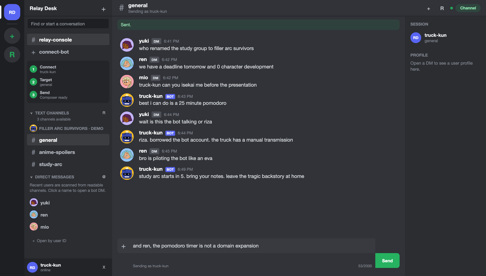
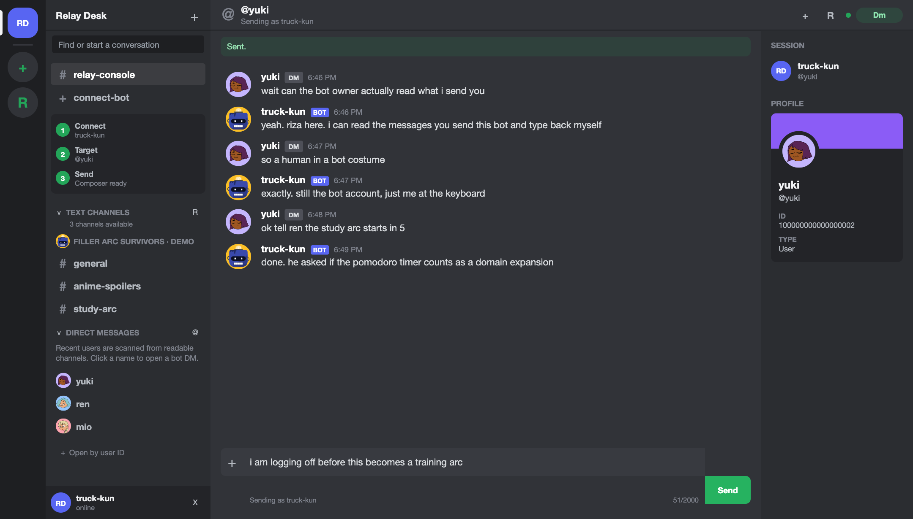

# Relay Desk — chat as your Discord bot

A self-hosted Discord bot chat client that lets you read messages and manually reply as your bot from a browser. Connect your own bot token, pick a server channel or open a bot DM, and type your response. Your message appears in Discord under the bot’s name.

You write the replies yourself. Relay Desk does not generate AI responses or require you to write bot commands.

## Use online — no installation

**[Open Relay Desk at rizamohamed.com/discord-bot](https://rizamohamed.com/discord-bot)**

Choose **Bot token**, paste your own Discord bot token, and start a session. Pick a channel or open a bot DM to read messages and reply. You can also choose **Webhook** for send-only messages. Use a bot token, never your personal Discord account token.

The hosted service is operated by Riza Mohamed. Connecting sends your credential to that service so it can call Discord on your behalf. Only use it if you trust the operator; self-host this repository if you prefer to control the server. The hosted service is a separate deployment; the session implementation described below applies to this repository's standalone server.

## See it in action



*A screenshot of the running app with fictional demo messages. The operator is typing as truck-kun; the BOT badge identifies the account sending each reply.*

<details>
<summary>See a one-to-one conversation from the bot account</summary>



*The same bot account, with a direct message selected and the recipient’s profile visible. Demo conversation; no real Discord messages or credentials are shown.*

</details>

## Can a Discord bot owner see my messages and reply personally?

**Yes. If you send a message to a Discord bot, its owner can use software such as Relay Desk to read messages available to that bot and manually reply through its account.** A BOT badge identifies the account; it does not mean every reply is automated or AI-generated.

In Relay Desk, the owner connects their bot token, opens the channel or your bot DM, reads the sent messages, and types a reply. You receive that reply from the bot account, with its name and BOT badge—not from the owner's personal account.

The owner cannot see unsent text in your composer, unrelated private DMs, or channels the bot cannot access. Server message access depends on Discord permissions and Message Content intent requirements. Bot DMs are messages sent directly to that bot. Relay Desk loads the latest 50 messages and refreshes on request; it does not show live typing or automatically list every incoming DM. The owner can open a bot DM using the sender's user ID.

See Discord's [bot data access explanation](https://support.discord.com/hc/en-us/articles/7933951485975-Visibility-of-Bot-Data-Access) and [message API documentation](https://discord.com/developers/docs/resources/message).

## Use your bot account to join the conversation

- **Reply as your Discord bot:** read a channel and type a response under the bot’s identity, without writing a script for each message.
- **Handle a conversation personally:** answer a community question or follow up in a bot DM when a human reply is useful.
- **Test bot messages:** check channel access and message formatting while developing your own Discord application.
- **Send through a webhook:** post to one channel when you only need outgoing messages.

### Try it without a Discord token

```bash
git clone https://github.com/codewithriza/relay-desk.git
cd relay-desk
npm run demo
```

Open [http://localhost:3001](http://localhost:3001) and enter `demo` in the bot token field. The local demo uses fictional chats, accepts replies, and lets you open yuki’s DM. It binds to your local machine and never connects to Discord. Restart it to reset the messages.

### Send a real reply as your bot

1. Start the app with `npm start` and open [http://localhost:3000](http://localhost:3000).
2. Connect your Discord bot token using the setup steps below.
3. Choose a channel and read the conversation. Press **Refresh** to load new messages.
4. Type your reply and press **Send**. Discord displays the reply as your bot.
5. To continue privately, click **DM** beside a person. Discord must allow the bot to message that user.

## What it does

| Mode | What you can do | What you need |
| --- | --- | --- |
| **Bot token** | Browse available server text channels, read the latest 50 messages, send replies, and open a one-to-one bot DM. | Your own Discord application and bot token. |
| **Webhook** | Send a message to the webhook's channel. | A Discord webhook URL. |

The interface refreshes messages when you press **Refresh** or send a message. It does not stream new messages in real time. Webhooks cannot browse or read chat history.

## Run it locally

You need **Node.js 20 or newer** for the app and demo. There are no runtime packages to install.

```bash
git clone https://github.com/codewithriza/relay-desk.git
cd relay-desk
npm start
```

Open [http://localhost:3000](http://localhost:3000). For a different port, run `PORT=4000 npm start`.

### Connect your bot

1. Create an application and bot in the [Discord Developer Portal](https://discord.com/developers/applications).
2. Install the bot in the server you want to use. Give it **View Channel**, **Read Message History**, and **Send Messages** in the relevant channels.
3. Enable the **Message Content** privileged intent if you need the text of other users' messages. Discord controls access to this intent.
4. Paste the **bot token** into Relay Desk. If a channel does not show up, paste its channel ID into **Fallback channel ID** and reconnect.

Use a bot token, not a personal Discord account token. Discord does not permit self-bot automation. A bot can only see and send in places where it has permission.

### Connect a webhook

Switch to **Webhook**, paste a Discord webhook URL, and send a message. This mode is intentionally send-only; a webhook has no general channel-history endpoint.

## How the session works

```text
Your browser ── bot token or webhook URL ──▶ Your Relay Desk server
Your browser ◀── session cookie + chat data ── Your Relay Desk server ──▶ Discord API
```

- Credentials are held **in the server process's memory** for up to two hours and removed on disconnect or restart. They are not written to a database, local storage, cookies, or logs.
- The browser receives a random, `HttpOnly`, `SameSite=Strict` session cookie. Production cookies also use `Secure`.
- Writes require a same-origin browser request. Webhook URLs are restricted to Discord's HTTPS webhook hosts, and sends disable automatic mentions.
- Whoever operates the server can access its process memory and incoming credentials. Only enter a bot token on an instance you trust.

This server uses local memory for sessions, so run **one long-lived Node process**. Serverless platforms or multiple replicas need a shared session store before they are suitable for this version. See [SECURITY.md](SECURITY.md) for the threat model.

## Host it

Put the Node server behind HTTPS and set its exact public origin:

```bash
NODE_ENV=production PUBLIC_ORIGIN=https://relay.example.com PORT=3000 npm start
```

Point your reverse proxy at `localhost:3000`, pass the original `Host` header, and terminate TLS at the proxy. The app serves from `/`, including `/api/*`; it is not configured for a path prefix. A public instance lets any visitor connect their own bot, so use a host you control and keep the server updated.

## Project map

```text
public/          Relay Desk interface, styles, and icon
src/app.js       HTTP routes, session cookies, and static files
src/discord.js   Discord API client and response formatting
src/server.js    Server entry point
test/            Session, origin, webhook, and message tests
scripts/         Local demo with fictional conversations
```

Run `npm test` before changing the API or credential flow.

Demo profile artwork: [credits and licenses](scripts/demo-avatars/README.md).

## Contact

Built by **Riza Mohamed**. For a bug or feature idea, open an issue in this repo or email [hi@rizamohamed.com](mailto:hi@rizamohamed.com). More projects: [rizamohamed.com](https://rizamohamed.com) · [GitHub](https://github.com/codewithriza).

Discord and its logos belong to Discord Inc. Relay Desk is an independent project and is not affiliated with Discord.
